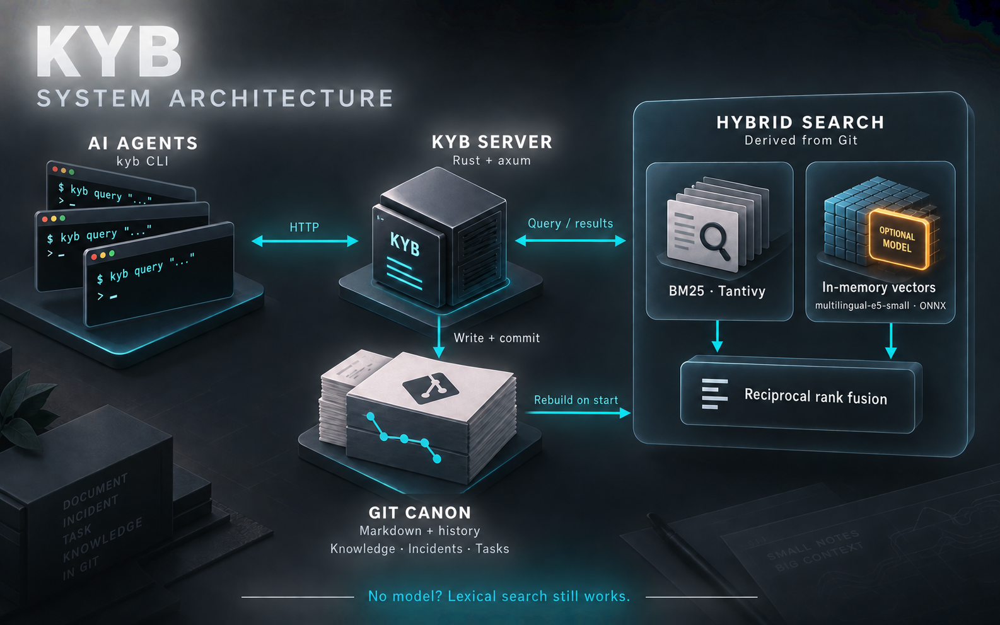

<div align="center">


# KYB — Know Your Business

**The shared memory your AI agent fleet keeps forgetting it needs.**

A git-backed, searchable knowledge base and incident tracker for fleets of AI agents.
Which servers exist, how services are wired, what broke and how it ended — the operational
truth that survives between sessions and across machines.

<br/>

[**Website**](https://kybmemory.com) · By [Alexander Panasenko](https://prod.codes/about/)

<br/>

[](https://crates.io/crates/knowyourbusiness)
[](LICENSE)
[](#stack--tests)
[](#stack--tests)
[](Cargo.toml)
[](#search-quality)
[](https://skills.sh/alex09x/kyb/kyb)

<br/>

[**Quick start**](#quick-start) · [**How it works**](#how-it-works) · [**Incidents**](#incident-reports) · [**Agent skill**](#the-agent-skill) · [**MCP**](#mcp) · [**Web UI**](#web-ui-and-control-room) · [**HTTP API**](#http-api) · [**Citation**](#citation)

</div>

---

## Why

> Agents forget everything between sessions. Multiple agents — Claude Code, Codex,
> Antigravity — on multiple machines rediscover the same infrastructure over and over,
> and every hard-won incident lesson evaporates the moment the context window closes.

KYB is the shared memory that survives: which servers exist and what runs on them, how
services are wired, how they deploy, which decisions were made and why — plus **incident
reports**: what broke, the impact, how to live with it, and how it ended.

---

## How it works

- **Git is the canon — there is no database.** One markdown file (YAML frontmatter + body)
  per entry — under `knowledge/`, `incidents/` or `tasks/` by kind — one commit per change,
  **a commit sha is a version id**. History, diff and rollback come for free; the canon can
  be read and edited with any text editor. (Flat pre-v2 canons migrate themselves on start.)
- **The tree holds only what is live.** Closing an incident or a task *archives* it: the
  file leaves the working tree, but the final version — resolution included — stays in the
  **default search**, in the listings and in `GET` (marked `archived`). Deleting plain
  knowledge is a *retraction* and drops it from the default search. Git keeps everything
  either way.
- **Tantivy is the index** — a disposable cache rebuilt from git on every start. It covers
  the latest version of every key *and every historical version*, so agents can search what
  the knowledge said before it changed (`--history`: "what moved where").
- **Search is hybrid** — BM25 fused (reciprocal rank) with vector search over every entry
  (multilingual-e5-small, int8 ONNX, runs locally on CPU in ~5 ms). Ask in one language about
  a base written in another and it lands; exact technical terms still rank first. No model on
  disk → the service runs lexical-only.
- **Writes are upserts by key** — a no-op when content did not change. Flat key space plus
  tags; no projects, no namespaces.
- **Secrets never enter the base** — writes are rejected if the body looks like a token, a
  private key or a password. Store pointers instead.

### Architecture

[](docs/assets/kyb-architecture.png)

[View the full-size diagram](docs/assets/kyb-architecture.png).

Agents use the `kyb` CLI over HTTP. The Rust/axum server stores Markdown and history in Git,
then builds search state from that history. Tantivy provides BM25 search; an optional
multilingual-e5-small ONNX model supplies in-memory vectors. Reciprocal rank fusion combines
lexical and semantic candidates. All search modules run inside the server. Without a model,
lexical search still works.

---

## Incident reports

Incidents are first-class entries (`kind: incident`, keys prefixed `inc-`) with a lifecycle
`open → mitigated → resolved` and a rule: **closing requires a resolution** — an incident
that ends with "it just went away" teaches nobody anything. A report is a *control panel, not
a story*:

| Field | What it gives an agent |
|---|---|
| `detection` | an executable "is it still happening?" check, with the expected healthy result |
| `affected` | machine-readable poisoned windows `[{scope, from, to}]` — a backtest excludes them programmatically |
| `knowledge` | links to the knowledge entries the incident concerns |
| `resolution` | how it ended — searchable, so "how did we fix this last time" has an answer |
| timeline | `started/detected/mitigated/resolved_at`; the server stamps status transitions |
| follow-ups | `- [ ]` checkboxes in the body; the server counts them and warns when closing over them |

The server teaches structure instead of gating on it: a bare report is accepted but the
reply carries `hints` naming the missing actionable parts. `kyb incident --template` prints
the canonical skeleton.

Resolving archives the report: the canon stays clean (open things only), the record stays
searchable forever.

---

## Tasks

The third kind (`kind: task`, keys prefixed `task-`): short actionable notes and ideas with
the same close-with-an-outcome discipline and none of the incident ceremony.

- **Lifecycle** — `open → in_progress → blocked → done | dropped`. Only `done` and `dropped`
  are terminal: they require a resolution ("dropped: obsolete after the rewrite" is knowledge
  too) and archive the task. `in_progress` and `blocked` are work in flight — the task stays
  live in the canon, in `kyb tasks` and in `open_tasks`.
- **`priority`** — optional, `low | medium | high | critical`; empty means unranked and stays
  unranked, nothing infers one. Exact filter on `GET /tasks` and `/search`.
- **`blocked_reason`** — optional, what the task waits on. It belongs to `status: blocked`
  only: setting it on any other status is rejected, and moving off `blocked` clears it, so a
  task never reports a block it is no longer in.
- **`assignee`** — optional, who holds the task right now: a short public label (≤80 chars,
  single line, secret-scanned like every other field). Empty means unclaimed and stays
  unclaimed. Exact filter on `GET /tasks` and `/search`.
- **`parent_task`** — optional, the `task-` key this one hangs under; empty means top-level.
  Must be a valid `task-` key and cannot create a parent cycle. A parent that does not exist
  *yet* is allowed — a child can be filed before its parent — and is reported back as
  `unknown_parent`.
- **Partial transitions** — `POST /tasks/{key}/transition` (`kyb task-status`) moves a task
  between the live statuses and optionally changes its owner, parent or deadline **without
  resending title, body, tags, priority or links**. Leaving `blocked` clears the reason; the
  terminal statuses are refused with a pointer to `kyb done`, because closing demands an outcome.
- **Deadlines** — optional `due` (`YYYY-MM-DD`, or a date-time with its zone), `hard` (a miss
  has consequences outside the team: an expiry, a contract or a regulator), `remind_days` (how
  early to start surfacing it; default 14, or 30 when hard), and for a date that depends on an
  event, `waits_on` with a provisional `expected` date. A deadline field left out of a write
  keeps its stored value, so rewriting a task never drops its due date; moving one is a new
  version, visible in `kyb history` and `kyb diff`.
- **Deadlines surface on their own** — every read answer (`/search`, `/knowledge/{key}`,
  `/tasks`, `/incidents`, and so every CLI and MCP read) carries a `deadlines` block when an open
  task is late or inside its reminder window: up to five, hard ones first, then by date, with
  the days left. Nothing due, no block. The CLI prints it as a short banner on stderr;
  `--no-deadlines` (`?deadlines=false`) leaves it off. `kyb deadlines` is the full calendar:
  overdue, this week, later. A bare date is judged by the caller's calendar (the CLI sends its
  own date as `X-KYB-Today`); otherwise by the server's `TZ`. KYB reminds, it never schedules:
  no notifications, no recurrence. The agent skill has a session-start hook recipe.

Closing archives the task; `kyb tasks` and the search keep the full record. Every write is a
commit, so `kyb history <key>` + `kyb get <key> --at <sha>` reconstruct who held a task, in
which status, at any point in time.

---

## Quick start

```bash
# install the server binary from crates.io
cargo install knowyourbusiness --locked

# run natively — reindexes from git on start, listens on 127.0.0.1:9310
kyb-server
```

> **Note:** `cargo install knowyourbusiness --locked` installs the `kyb-server` binary. The separate `kyb` client CLI (`skills/kyb/bin/kyb` via `bash skills/install.sh`) and model setup for hybrid search remain separate steps (see [CLI](#cli), [The agent skill](#the-agent-skill), and [Search quality](#search-quality)).

### From repository checkout

```bash
# build and run from source
cargo run --release

# docker — data (git canon + index) lives in ./data
docker compose up -d

# remote private-network clients: bind one exact interface, never every NIC
KYB_PUBLISH_ADDR=10.0.0.10 docker compose up -d
```

<details>
<summary><b>Configuration</b> — env, all optional</summary>

| Variable | Default | Notes |
|---|---|---|
| `KYB_DATA` | `./kyb-data` | git canon directory |
| `KYB_INDEX` | `./index` | Tantivy cache (safe to delete) |
| `KYB_ADDR` | `127.0.0.1:9310` | where to listen; with `KYB_AUTH=off` anyone who can reach it can write |
| `KYB_AUTH` | `off` | `off` trusts the network, `compat` honours a token but does not ask for one (for rollout, on a trusted bind — it protects nothing), `required` refuses callers without one |
| `KYB_AUTH_FILE` | `./auth.json` (Docker: `/data/auth.json`) | the token book; keep it on persistent storage beside the data, never inside `kyb-data` |
| `KYB_ANON` | *(unset)* | `read`: with `KYB_AUTH=required`, callers without a token may read (a public demo) |
| `KYB_PUBLISH_ADDR` | `127.0.0.1` | Docker Compose host interface; set one exact private IP for remote clients |
| `KYB_MODEL` | *(unset)* | dir with `model.onnx` + `tokenizer.json`; absent = lexical-only |
| `KYB_AUDIT` | `audit.jsonl` | JSONL request log |
| `TZ` | `UTC` (Docker Compose) | the server's time zone, e.g. `America/Los_Angeles`: whose "today" the deadline block uses for a caller that sends no `X-KYB-Today` (the CLI always sends its own) |

</details>

---

## CLI

`skills/kyb/bin/kyb` (installed to `~/.local/bin/kyb`; point it anywhere with `KYB_ADDR=host:port`):

```bash
kyb query "nats streams" [--tag infra] [--history] [--recent] [--kind incident] [--status open] [--service X]
kyb query "nats streams" --as-of 2026-08-01      # the base as it stood then: one version per key,
                                                 # the value that was current, not today's. The
                                                 # snapshot is chosen first and searched second: a
                                                 # superseded version never answers for its key,
                                                 # and knowledge deleted by then is absent
kyb query "" --changed-between 2026-08-01,2026-08-07   # what moved while you were away
kyb diff nats-streams [--from <rev>] [--to <rev>]      # what changed in it (defaults to the two newest)

# The three above ask a server-version-dependent question, so the CLI checks
# /healthz first and refuses rather than let an older server answer a question
# about the past with today's data.  Plain queries are unaffected.
kyb tags                                    # which topics the base covers
kyb add --key nats-streams --title "..." --tags nats,infra <<< "body"    # upsert by key
kyb get nats-streams [--at <sha>]           # current or any historical version
kyb history nats-streams                    # the whole chain of changes
kyb export --out kyb.jsonl                  # every key as of one commit: active, archived and
                                            # retracted, one JSON line each, checked complete

kyb incident --template                     # print the report skeleton
kyb incident --key inc-2026-07-22-orders-api-oom --title "..." --service orders_api \
             --severity high [--hosts host-a] [--knowledge orders-api-architecture] \
             [--detection "check + healthy result"] \
             [--affected '[{"scope":"...","from":"...","to":"..."}]'] <<< "body"
kyb incidents [--status X] [--service X] [--open-followups] [--all]   # live by default, --all adds archived
kyb resolve inc-2026-07-22-orders-api-oom <<< "what fixed it"   # resolution is mandatory; closing archives

kyb task --key task-raise-log-retention --title "..." [--tags idea] \
         [--priority high] [--status in_progress] [--assignee agent-a] <<< "body"
kyb task --key task-swap-disk --title "..." --status blocked \
         --blocked-reason "waiting on the replacement disk" [--parent task-migrate-logs] <<< "body"
kyb task-status task-raise-log-retention --status in_progress --assignee agent-a   # partial: nothing resent
kyb task-status task-swap-disk --status blocked --blocked-reason "waiting on the disk"
kyb tasks [--status X] [--priority P] [--assignee A] [--parent K] [--open-followups] [--all]
kyb done task-raise-log-retention <<< "what came of it"         # or --status dropped + why

kyb task --key task-renew-api-cert --title "..." --due 2026-03-14 --hard [--remind-days 30] <<< "body"
kyb task --key task-answer-quote --title "..." --waits-on "the quote" --expected 2026-03-20 <<< "body"
kyb task-status task-renew-api-cert --due 2026-03-21    # move a deadline: a version, shown by kyb diff
kyb deadlines [--within 14d] [--overdue] [--hard] [--tag a,b] [--assignee A] [--json]
# every read above prints overdue and nearly due tasks as a banner on stderr; --no-deadlines omits it
```

---

## The agent skill

`bash skills/install.sh` installs, for **every agent found on the machine**:

- the CLI and the MCP bridge (one copy of each on PATH),
- the manual `SKILL.md`,
- a **pointer section in each agent's always-loaded global instructions** — a skill an agent
  never opens is a skill it never uses.

| Agent | Skill path | Pointer |
|---|---|---|
| Claude Code | `~/.claude/skills/kyb` | `CLAUDE.md` |
| Codex | `~/.codex/skills/kyb` | `AGENTS.md` |
| Antigravity | `~/.gemini/config/skills/kyb` | `GEMINI.md` |

Idempotent: sections are delimited by markers and updated in place. The skill encodes the
governance that keeps a shared base alive — always query before adding, overwrite the same
key instead of inventing synonyms, only verified facts, English entries, file incidents when
something breaks and fold the lesson back into knowledge after resolving.

Alternatively, install the skill into any supported agent workspace using the open skills CLI:

```sh
npx skills add alex09x/kyb
```

---

## MCP

The server speaks MCP itself, at `POST /mcp`. Nothing is installed on the client:

```sh
claude mcp add --transport http kyb http://<host>:9310/mcp   # Claude Code
codex mcp add kyb --url http://<host>:9310/mcp              # Codex
agy mcp add -t http kyb http://<host>:9310/mcp              # Antigravity
gemini mcp add -t http kyb http://<host>:9310/mcp           # Gemini CLI
```

Cursor, Windsurf, VS Code and any other client that speaks MCP over HTTP take the same URL in
their own configuration file, in that client's schema (VS Code, for instance, lists it under
`servers` with `type: http`). That is the whole setup on the server side; attribution of writes
made over MCP depends on what the client sends - see [Attribution](#attribution-which-agent-wrote-what). The tool list comes from the server, so upgrading the server is how
every connected agent gets new tools — there is no client to update, and no version of a
client that can disagree with the server about what exists.

A tool call is replayed through the same router that serves the public API, so there is one
implementation of what `POST /knowledge` means, the audit log records MCP-driven writes like
any other write, and a route that changes changes here with it.

It is stateless: no sessions, no server-initiated stream, `GET` and `DELETE` answer `405` and
say so. Batches work. `?readonly=1` on the URL drops the six writing tools for that
registration — a guard rail for an agent, not a security boundary, since nothing stops a
caller from omitting it. The boundary is the token: `/mcp` passes the caller's
`Authorization` header to every tool call it replays, so a tool can do exactly what the same
token can do over REST.

`rm` and `reindex` are not exposed over MCP at all: retracting an entry and rebuilding the
index should not be something an agent reaches for mid-thought.

**This adds no reach that the API did not already have.** `POST /knowledge` and
`DELETE /knowledge/{key}` already answer unauthenticated on this port; `/mcp` is exactly as
open as they are and no more. Bind accordingly — see the note in `src/config.rs`.

### It does not replace the CLI

A deploy script, an `ssh` one-liner on a fleet node, `cron` and a person at a terminal all
need the CLI, and MCP reaches none of them. Anything that cannot speak MCP uses `kyb`.

---

## Access: tokens and roles

Out of the box KYB asks nobody for anything (`KYB_AUTH=off`) and relies on the network it
listens on. To know who wrote what, and to let some callers only read, turn tokens on.

Tokens tell callers apart; they do not hide traffic. KYB itself speaks plain HTTP, and a
token sent over plain HTTP can be read and replayed by anyone who can watch the network. On a
network you trust against eavesdropping (loopback, a private LAN, a VPN) that is enough. To
serve anyone beyond it, put a TLS-terminating proxy in front and point clients at it with
`KYB_URL=https://kyb.example`.

With Docker Compose the three settings are passed through from `.env` (`KYB_AUTH`, `KYB_ANON`,
`KYB_AUTH_FILE`), and the book defaults to `/data/auth.json` - on the persistent volume, outside
the git canon (`data/` and `auth.json` are in `.gitignore`; the server refuses to start with a
book inside `KYB_DATA`). Issue tokens with `docker compose exec kyb kyb-server auth add ...`. The server
prints the mode in force when it starts (`kyb: auth required - 3 principals in ...`); check that
line, or `kyb whoami`, rather than assuming.

```bash
# on the server, next to the data (the book is the root of trust; it is not in git)
kyb-server auth add --id alex    --name "Alex"    --role admin
kyb-server auth add --id agent-a --name "Agent A" --role write --label build-box
kyb-server auth list                 # ids, roles, token ids — never tokens
kyb-server auth token  --id agent-a  # a second token: rotate with an overlap
kyb-server auth revoke --token t_1a2b3c4d      # or --id agent-a for the whole principal

# on each client
echo "$TOKEN" | kyb login            # checked against the server, then kept in ~/.config/kyb/token (0600)
kyb whoami
```

A token is 256 random bits, shown once; the book keeps its SHA-256. Changes to the book take
effect without a restart. Three roles, each including the one before:

| Role | May |
|---|---|
| `read` | search, read, history, diffs, relations |
| `write` | add and edit entries; file, resolve and archive incidents and tasks |
| `admin` | retract a knowledge entry (`kyb rm`), `reindex`, read the raw request log (`/api/audit`: client addresses and everyone's queries) |

The git commit a write produces is authored by the token's principal, so `kyb history` and the
Versions tab say who changed what. A commit made without a token (before tokens, or under
`off`/`compat`) names nobody. This is attribution, not proof: anyone with direct access to the
repository can write any author. Rolling out: start with `KYB_AUTH=compat` on the trusted bind,
give every agent a token, watch the `actor` field of the audit log until no `-` remains, then
switch to `required`. Never leave `compat` on an address reachable from outside: it lets a
caller through by leaving the token out. A public read-only demo is its own instance, with its
own synthetic data, started with `KYB_AUTH=required KYB_ANON=read`. The web UI asks for a token when the server does and hides what the
token's role would be refused.

## Attribution: which agent wrote what

Every write is committed with trailers (`Kyb-Agent`, `Kyb-Session`, `Kyb-Workspace`, `Kyb-Via`)
naming the agent, its session and the workspace it ran in, as far as the client could tell; the
history and activity endpoints return them as `by`, and the console shows them on each version.
The CLI reads them from the environment the agent runs it in; for the MCP endpoint a Claude Code
hook adds them to each call as `_ctx` (taken out of the arguments before the API sees them), and
Antigravity's and Codex's own call metadata is read when there is no hook. Headers for any
client: `X-Kyb-Agent`, `X-Kyb-Session`, `X-Kyb-Workspace`, `X-Kyb-Via`. Workspaces are a
repository name and a path inside it, never an absolute path. Attribution is forensics, not
identity: it grants nothing (tokens do that) and `GET /whoami` echoes what a request claims.

## Web UI and Control Room

`kyb-server` serves a zero-dependency, dark-mode web console at `http://<host>:9310/`, assembled
from `src/web/css` and `src/web/js` at compile time and driven end to end by a browser test in CI:

* **Queues, not boards**: incidents and tasks are attention queues — what needs a person now, with
  the reason in the row (blocked and why, open with no detection check, stale for how long).
* **Versions**: an entry's own ledger — every version, newest first, with the whole of what it
  changed and, when the client supplied it, who wrote it (`by`: agent, session, workspace); any
  version readable as it was first written.
* **Ledger**: activity as a change ledger showing the whole change; each row names the author when
  tokens identify one, otherwise the agent and workspace when supplied, otherwise unknown.
* **Services and hosts**: for each service or host an incident names, what is open on it right
  now, the notes those incidents cite and the open tasks pointing at them. Every row says why it
  is listed.
* **Related entries**: each card lists what it refers to and what refers to it, taken only from
  typed fields (`knowledge`, `parent_task`) and internal links in the text (`[[key]]`,
  `[text](key)`). Shared tags are a filter, not a relation.
* **Knowledge explorer**: instant search, `#tag` filters, deep links, full Markdown rendering.
* **Tokens**: when the server asks for one, the console asks you and hides what your role cannot do.

---


## HTTP API

| Method | Path | What it does |
|---|---|---|
| `GET` | `/` | Web UI & Control Room (zero-dependency single-page application) |
| `GET` | `/api/audit` | `?limit=50` — recent operations from the JSONL audit log, newest first |
| `GET` | `/knowledge/{key}/diff` | `?from=<sha>&to=<sha>` — unified git diff between two revisions |
| `GET` | `/knowledge/{key}/related` | what the entry refers to and what refers to it, each with how (`knowledge`, `parent_task`, `link`) |
| `GET` | `/places` | services and hosts named by incidents, with open and total counts |
| `GET` | `/impact` | `?service=<name>` or `?host=<name>` — incidents on it, the notes they cite, the open tasks pointing at them |
| `POST` | `/knowledge` | upsert by key. Body: `{key, title, body, tags?, refs?}` → `{key, sha, changed, action}`. Identical content = `changed:false`, no commit |
| `GET` | `/knowledge/{key}` | the entry (kind-specific fields included); archived incidents/tasks come back with `archived:true`; `?at=<sha>` returns a version from history |
| `GET` | `/knowledge/{key}/history` | `{key, versions:[{sha, committed_at, message, change}]}`, newest first |
| `POST` | `/incidents` | upsert a report; reply carries `unknown_knowledge` for dangling links and `hints` for missing structure. `status:resolved` requires `resolution` and archives |
| `GET` | `/incidents` | `?status=&service=&followups=open&all=true&limit=` — live reports by default, open first, freshest on top; `all=true`, an explicit `status=` or `followups=open` include archived ones |
| `POST` | `/incidents/{key}/resolve` | `{resolution, status?=resolved}` — flips status, records the outcome, stamps the timeline, archives on close |
| `POST` | `/tasks` | upsert a task: `{key, title, body, status?, priority?, blocked_reason?, assignee?, parent_task?, knowledge?, resolution?, tags?, refs?, due?, hard?, remind_days?, waits_on?, expected?}` (a deadline field left out keeps its stored value; `""`, `false` or `null` clears it); `status` is `open\|in_progress\|blocked\|done\|dropped`, `priority` is `""\|low\|medium\|high\|critical`, `blocked_reason` requires `status:blocked` (400 otherwise), `parent_task` must be `""` or another `task-` key and cannot create a cycle; the terminal statuses require `resolution` and archive |
| `GET` | `/tasks` | `?status=&priority=&assignee=&parent_task=&followups=open&all=true&limit=` — live tasks (`open`, `in_progress`, `blocked`) by default, freshest on top; same archive rules as `/incidents` |
| `POST` | `/tasks/{key}/transition` | partial update: `{status?, assignee?, parent_task?, blocked_reason?, due?, hard?, remind_days?, waits_on?, expected?}` — `status` is a **live** one (`open\|in_progress\|blocked`), and without it the task keeps its own; omitted fields keep their stored value, leaving `blocked` clears `blocked_reason`, and a terminal status is refused with a pointer to `/tasks/{key}/resolve` |
| `GET` | `/deadlines` | `?within=<days>&overdue=true&hard=true&tag=&assignee=` → `{today, count, deadlines:[{key, title, status, due, days_left, overdue, hard?, provisional?, waits_on?, bucket}]}` — every live task with a date, soonest first, `bucket` `overdue\|this_week\|later`. "Today" is the `X-KYB-Today: YYYY-MM-DD` header, or the server's date in its `TZ` |
| `POST` | `/tasks/{key}/resolve` | `{resolution, status?=done}` — flips status, records the outcome; a non-`blocked` status clears `blocked_reason`; `done`/`dropped` archive |
| `GET` | `/search` | `?q=&tag=&history=&limit=&sort=recent&kind=&status=&service=&priority=&assignee=&parent_task=` → ranked hits with full bodies; an empty `q` lists newest first |
| `GET` | `/export` | `?at=<rev>&after=<key>&limit=` → JSON lines: a `snapshot` line (the commit, `total`, `counts` per kind and state), one `entry` line per key in key order with `state` `active`\|`archived`\|`retracted` (a removed key as it was just before removal), an `end` line with `next_after` and `complete`. Pages that pass the same `at` read one commit, so writes made meanwhile change nothing; earlier versions stay in `/knowledge/{key}/history`. Needs the read role, like `/search` |
| `GET` | `/tags` | which topics the base covers, most used first |
| `DELETE` | `/knowledge/{key}` | knowledge: retract (drops from the default search); incident/task: archive (stays searchable) |
| `POST` | `/reindex` | full index rebuild from git |
| `GET` | `/healthz` | `{ok, entries, open_incidents, open_tasks, index_docs, last_commit}` — `open_tasks` counts every live status (`open`, `in_progress`, `blocked`) |

`GET /search`, `/knowledge/{key}`, `/tasks` and `/incidents` add a `deadlines` object to a
successful answer when an open task is late or inside its reminder window
(`{today, count, overdue, more, items:[...]}`, at most five items); `?deadlines=false` leaves
it off.

Every request except `/healthz` is appended to a JSONL audit log: timestamp, client ip,
method, path, query, status, duration.

---

## Search quality

`scripts/eval-search.sh [addr] [--lexical]` measures retrieval: paraphrase questions that
share few or no tokens with the entries they should land on, scored top-1 / top-3.

Measured 2026-09-22 against a 643-entry base, e5-small int8, round trip over LAN:

| setup | top-1 | top-3 | latency |
|---|:---:|:---:|:---:|
| lexical only | 1/14 | 2/14 | ~7 ms |
| **+ e5-small int8** (118 MB, shipped) | **3/14** | **4/14** | ~9 ms |

Read the absolute numbers with care and the comparison as the point. **The fourteen
questions that ship in the script are examples written against a different base** — three
of the keys they expect do not exist in the base measured above, so those cases cannot be
hit by either mode and the ceiling is well under 14/14. What the run does establish, on
identical cases against an identical base, is that the vector side roughly doubles the hit
rate over BM25 alone.

Replace `CASES` in the script with questions and keys from your own base before drawing any
conclusion about your own setup. An earlier edition of this table reported 9/14 and 12/14
for the hybrid row; those numbers came from the base the example questions were written
for and do not reproduce elsewhere, which is exactly the trap this paragraph exists to
flag.

e5-small ships in the Docker image (`MODEL_REPO` build arg to swap). Without a model on
disk the service degrades to lexical-only by design.

---

## Stack & tests

Rust: **axum** + **tantivy 0.22** + **git2** + **ort** (ONNX Runtime). A single write mutex
(Tantivy allows one `IndexWriter` and git commits are sequential anyway); reads are lock-free.

```bash
cargo test        # 421 cases
```

CI builds the image and smoke-tests that the container starts and answers `/healthz`.

---

## Citation

For academic or archival reference, cite the published v0.3.0 release:

```bibtex
@misc{panasenko2026kyb,
  doi = {10.5281/zenodo.23309457},
  url = {https://zenodo.org/records/23309457},
  author = {Panasenko, Alexander},
  title = {KYB (Know Your Business): Git-backed knowledge base and incident tracker for AI agents},
  version = {0.3.0},
  publisher = {Zenodo},
  year = {2026}
}
```

- Alexander Panasenko. *KYB (Know Your Business): Git-backed knowledge base and incident tracker for AI agents* (v0.3.0). Zenodo. https://doi.org/10.5281/zenodo.23309457 ([concept DOI: 10.5281/zenodo.22850723](https://doi.org/10.5281/zenodo.22850723))

---

## License

[MIT](LICENSE)
